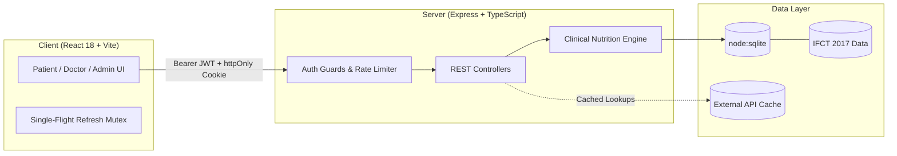

<div align="center">

# 🌿 Nutronics — Smart Health Companion
**Personalized Wellness Powered by AI, Verified Nutrition Data, and Clinical Oversight**

[](https://sdgs.un.org/goals/goal3)
[](https://nodejs.org)
[](https://www.typescriptlang.org/)
[](https://react.dev/)
[](https://expressjs.com/)
[](https://nodejs.org/api/sqlite.html)
[](https://github.com/Harshy-cmd/Nutronics)

[Features](#features) • [Architecture](#architecture) • [Quick Start](#setup) • [API Reference](docs/API.md) • [Demo Accounts](#demo-accounts)

</div>

---

## 📌 Overview

**Nutronics** is an offline-first digital health companion designed to advance **UN Sustainable Development Goal 3 (Good Health & Well-Being)**. Managing chronic conditions—such as Type 2 Diabetes, Hypertension, and Chronic Kidney Disease—demands strict nutritional vigilance and routine symptom tracking, yet patients rarely receive continuous guidance between clinic visits.

Nutronics bridges this divide through an evidence-based **physician-in-the-loop review architecture**. It delivers condition-tailored meal recommendations, medication reminders, biometric logging, and AI guidance, while keeping all business logic and clinical safety thresholds encapsulated behind an extensible REST API.

---

<a id="features"></a>
## ✨ Key Features

- 🥗 **Condition-Aware Nutrition Engine**: Validates dietary choices against clinical limits using 542 foods and 16 composite dishes from the **ICMR-NIN Indian Food Composition Tables (IFCT 2017)** and USDA FoodData Central.
- 🩺 **Doctor-in-the-Loop Oversight**: Patient meal substitutions and AI guidance flag as pending in a dedicated clinical queue for physician review, approval, or notes.
- 🔐 **Dual-Token Authentication**: 15-minute access tokens (`v: 2` claim) paired with rotated 7-day `httpOnly` refresh cookies, single-flight client mutex, 10-second grace window, and automatic session revocation on token reuse.
- 📈 **Biometric & Adherence Trends**: Visualizes blood pressure, glucose, hydration, and care-plan adherence via responsive Recharts graphs.
- ⏰ **Care Reminders & Logging**: Daily medication and water schedules with one-tap status toggles and historical tracking.
- 🚨 **Emergency Protocol**: Single-tap SOS trigger recording incident details and surfacing emergency caregiver contacts.
- 👥 **Multi-Role Portals**: Dedicated, role-scoped interfaces for **Patients**, **Doctors**, and **Administrators**.

---

## 🛠️ Tech Stack

| Layer | Stack |
|---|---|
| **Frontend** | React 18, TypeScript, Vite 6, Tailwind CSS, React Router 6, Recharts, Lucide React |
| **Backend** | Node.js (>=22.5), Express 4, TypeScript, Zod, bcryptjs, google-auth-library, Nodemailer |
| **Database** | Native `node:sqlite` (zero node-gyp native addon compilation; synchronous WAL mode) |
| **Clinical Datasets** | ICMR-NIN IFCT 2017, USDA FoodData Central, openFDA Drug Labels & RxNorm |
| **Security & Auth** | Dual-token rotation, `httpOnly` cookies, SHA-256 token hashing, IP rate limiting, CORS |

---

<a id="architecture"></a>
## 🏛️ System Architecture



---

<a id="setup"></a>
## 🚀 Installation & Setup

### Prerequisites
- **Node.js**: `>= 22.5.0` (required for native `node:sqlite`).
- **npm**: `>= 10.0.0`.

### Quick Start
```sh
# 1. Clone repository and install dependencies across workspaces
git clone https://github.com/Harshy-cmd/Nutronics.git
cd Nutronics
npm install

# 2. Copy and configure environment variables
cp .env.example .env

# 3. Initialize SQLite schema, demo records, and IFCT 2017 nutrition dataset
npm run db:setup

# 4. Start concurrent development servers (API: 4000, Client: 5173)
npm run dev
```

Visit **`http://localhost:5173`** to access the web application. The REST API health endpoint runs at **`http://localhost:4000/api/health`**.

### Production deployment

The Vercel client is a static frontend; it does not host the Express API. This repository includes a Render Blueprint in `render.yaml` for the API, with a persistent disk for SQLite and uploaded records.

1. Push this repository to GitHub and create a **Blueprint** in Render from it. Render reads `render.yaml` and generates `JWT_SECRET`. The API starts at `/api/health` and seeds the demo data on its first start.
2. Copy the API's Render URL, such as `https://nutronics-api.onrender.com`.
3. In Vercel, open **Project Settings → Environment Variables** and add `VITE_API_URL` with the value `https://nutronics-api.onrender.com/api` for **Production**.
4. Redeploy the Vercel client so the build includes the new URL.

The Blueprint uses Render's free web-service tier. Its filesystem is ephemeral: user-created data and uploaded records can disappear when Render restarts or spins down the service. Free services can also take about a minute to wake after 15 minutes without traffic. Use this deployment for a demo, not for storing real health records.

---

## 📊 Dataset Ingestion & Management

Nutronics includes automated CLI data pipelines for clinical datasets:

| Script | Command | Network Requirement |
|---|---|---|
| **Full Setup** | `npm run db:setup` | Offline (seeds base schema, demo users & IFCT 2017 data) |
| **IFCT Import** | `npm run db:import:ifct` | Offline (imports 542 foods + 16 composite recipe dishes) |
| **USDA Import** | `npm run db:import:usda` | Online (gap-fills Western foods via `USDA_API_KEY`) |
| **openFDA Import** | `npm run db:import:openfda` | Online (fetches labels, warnings & RxNorm via `OPENFDA_API_KEY`) |
| **All Datasets** | `npm run db:import:all` | Sequentially executes IFCT, USDA, and openFDA importers |

---

<a id="demo-accounts"></a>
## 🔑 Demo Accounts

When `VITE_SHOW_DEMO=true` in `.env`, instant demo buttons appear on the login screen. All demo accounts use password: `password123`.

| Role | Email | Clinical Focus |
|---|---|---|
| **Patient** | `patient@nutronics.org` | Aarav Sharma (68) — Type 2 Diabetes & Hypertension |
| **Patient** | `meera@nutronics.org` | Meera Nair (72) — Chronic Kidney Disease (Stage 3) |
| **Patient** | `kabir@nutronics.org` | Kabir Verma (58) — Cardiovascular Health & Obesity |
| **Doctor** | `doctor@nutronics.org` | Dr. Priya Menon — Internal Medicine & Clinical Nutrition |
| **Admin** | `admin@nutronics.org` | Vikram Desai — Systems Administrator |

---

## 📁 Project Structure

```
Nutronics/
├── client/                     # Frontend SPA workspace (React + Vite)
│   ├── src/
│   │   ├── components/         # Reusable UI (Stat, Card, Badge, QuickLinks)
│   │   ├── pages/              # Portal views (Patient, Doctor, Admin, Auth)
│   │   ├── api.ts              # Fetch client with single-flight refresh mutex
│   │   └── App.tsx             # Route declarations & role guards
├── server/                     # Backend REST API workspace (Node.js + Express)
│   ├── scripts/                # Data pipelines (IFCT, USDA, openFDA) & test suites
│   ├── src/
│   │   ├── db/                 # Database schema definitions & seeding (node:sqlite)
│   │   ├── middleware/         # JWT validation, role authorization & rate limiting
│   │   ├── routes/             # Modular REST routers (auth, patient, doctor, admin)
│   │   ├── services/           # Nutrition engine, starter data & threshold checks
│   │   └── index.ts            # Server entrypoint and Express middleware chain
├── docs/                       # Technical specifications
│   ├── API.md                  # REST API reference, proxy settings & auth claims
│   └── DATA_SOURCES.md         # Clinical sources, guidelines & safety notes
└── package.json                # Root workspace configuration
```

---

## 🔮 Roadmap

- [ ] **Cross-Platform Mobile App**: Flutter client consuming the existing REST API.
- [ ] **Cloud Database Migration**: PostgreSQL / Supabase adapter for multi-tenant production deployments.
- [ ] **Direct Wearable Telemetry**: Web Bluetooth and Health Connect synchronization for real-time vitals.
- [ ] **Critical Clinical Webhooks**: Automated push/SMS notifications to physicians for abnormal biometrics.

---

## 👨‍💻 Author & Connect

**Harsh Yadav**
- **GitHub**: [@Harshy-cmd](https://github.com/Harshy-cmd)
- **Repository**: [github.com/Harshy-cmd/Nutronics](https://github.com/Harshy-cmd/Nutronics)

---

## ⚠️ Medical Disclaimer

*Nutronics is an engineering demonstration and academic project aligned with UN SDG 3. It is **not a certified medical device** and does not provide clinical diagnosis, medical treatment, or prescription advice. Always consult a qualified physician or healthcare provider for medical advice.*
